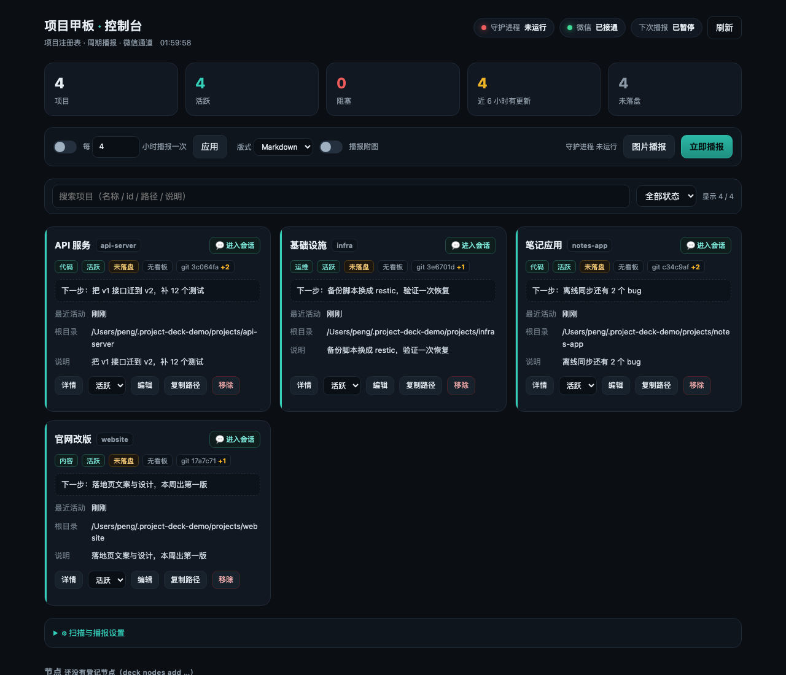

# dsh-project-deck

[](https://www.npmjs.com/package/dsh-project-deck)

**把你的仓库、目录和半途项目，变成一块看得见进度的甲板。**
A project deck for [DeepSeek Harness](https://github.com/deepseek-ai/deepseek-harness)：项目注册表 + 可视化面板 + 定时微信播报 + 自动发现 + 多机扫描。



## 30 秒 demo

不需要装任何东西（要 Python 3.9+）：

```bash
git clone https://github.com/peng456/dsh-project-deck
cd dsh-project-deck
python3 backend/deck demo          # 生成 4 个假项目，起面板
# → http://127.0.0.1:9299
```

## 它解决什么

你有 10 个仓库、3 个半成品、一堆会话散在不同工作区。这个插件做四件事：

1. **一个注册表**：`deck add <id> --root <path>`，别名、类型、优先级、下一步。
2. **一块面板**：卡片看 git 状态、最近活动、下一步；点项目标题直接跳进它最近的 DSH 会话。
3. **定时播报**：每 4 小时推一条微信（文字 + 看板图），有变化的项目优先，没变化的折叠一行；凌晨 0:30–6:30 不打扰。
4. **自动发现 + 多机扫描**：扫 DSH 工作区、git 仓库、标记文件自动登记新项目；手机/另一台电脑跑一个只读扫描器，把项目清单推给主机。

## 安装

```bash
# 1. 后端（CLI + 面板 + 定时器）
git clone https://github.com/peng456/dsh-project-deck && cd dsh-project-deck && ./install.sh

# 2. DSH 插件（npm 或 GitHub 二选一）
dsh plugin --profile desktop add dsh-project-deck
# dsh plugin --profile desktop add github:peng456/dsh-project-deck
# 或 Desktop → 插件 → 搜索/安装 dsh-project-deck
```

重启 DSH 后左下角出现 📋，**可以拖到页面任意位置**，位置会被记住；点开就是面板。

## 常用命令

```bash
deck add blog --root ~/code/blog --kind content --note "每周一篇实测"
deck list / status / doctor
deck report               # 立刻播报（文字 + 图）
deck scan / scan --add    # 发现新项目
deck nodes add --id phone --name "我的手机" --platform android
deck demo                 # 演示环境
```

## 播报长什么样

```
项目播报 · 11-05 06:49
12 个项目｜活跃 12 · 阻塞 0 · 近 6 小时更新 3

- **个人 Agent**（代码）· 刚刚
  进展：新增 1 个会话（共 5）·「多项目管理机制」
  下一步：给 12 个项目建 STATE 骨架
- **API 服务**（代码）· 12 分钟前
  进展：git 2 次提交（fix: 鉴权）· 3 个文件待提交
  下一步：迁 v2 接口，补 12 个测试
无变化：官网改版、基础设施、…
```

## 配置（`~/.project-deck/config.json`）

| key | 默认 | 说明 |
|---|---|---|
| `report.intervalHours` | 4 | 播报周期 |
| `report.image` | true | 附看板图（需要 Chrome 无头截图） |
| `scan.intervalHours` | 12 | 自动发现周期 |
| `scan.threshold` | 70 | 自动登记分数线 |
| `schedule.quiet` | 00:30–06:30 | 安静时段，不播报不扫描 |
| `panel.allowLanRead` | true | 允许手机通过局域网看面板（只读） |

## 多机扫描

节点只读上报，不传文件内容：

```bash
# Python / Node / Windows PowerShell 三种实现都在 backend/
python3 deck-node push --server http://<host>:9199 --token <token> --id my-phone
node     deck-node.js loop --server ... --token ... --id my-laptop
powershell -File deck-node.ps1 -Server ... -Token ... -Id my-win
```

## 安全

- 面板写接口只对本机开放；读接口可开局域网（给手机看），`POST /api/node-scan` 始终要每节点 token；
- 微信推送走本地 `wxpush`（iLink）；token 几小时无互动会过期，播报会跳过而不是堆积，你给 bot 发一句话就自动恢复；
- 别提交 `nodes.json` / `config.json`（里面有 token）。

## 许可

MIT
